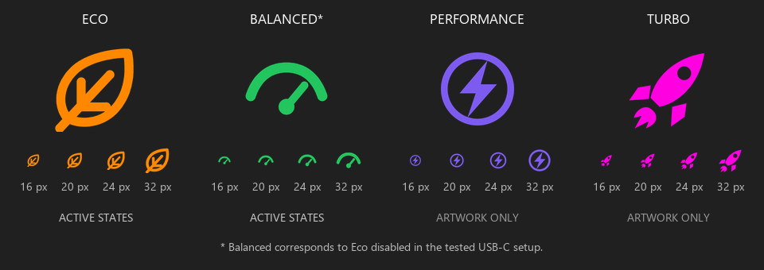

# Predator Mode Indicator

A small Windows notification-area indicator for the **Eco state saved by Acer PredatorSense**. An orange leaf means Eco is enabled; a green gauge means Eco is disabled. It refreshes every five seconds without changing power settings or touching hardware controls.

[Português](README.pt-BR.md) · [Download](https://github.com/MoisesGorisch/predator-mode-indicator/releases/latest)



## What it currently detects

| Icon | Meaning |
| --- | --- |
| Orange leaf | PredatorSense saved `Enable_Eco: 1` |
| Green gauge | PredatorSense saved `Enable_Eco: 0` |
| Gray dot | Missing, unreadable, invalid or unsupported state |

**Green does not universally mean Balanced.** It corresponds to Balanced in the tested USB-C setup, where only Eco and Balanced were available. With the original charger, Eco disabled can also mean Quiet, Performance or Turbo. The purple lightning and magenta rocket artwork is included for future use; this version does **not** detect Performance or Turbo separately.

The app reads `%ProgramData%\OEM\PredatorSense\ProfilePool\config.json`. This is a saved software state, not a direct firmware sensor, the Windows power plan or a USB-C power measurement. If PredatorSense stops updating the file, the icon can remain stale. The format is an undocumented implementation detail and may change.

## Compatibility

Tested locally on **Acer Predator Helios Neo 16 PHN16-71**, Windows, PredatorSense **5.0.1463**, with a USB-C PD charger and the Eco/Balanced pair of modes. Other models and PredatorSense versions are unverified. Requires Windows with .NET Framework 4.x and a compatible PredatorSense state file. Application menus are currently in Brazilian Portuguese.

## Use

1. Download the portable ZIP from [Releases](https://github.com/MoisesGorisch/predator-mode-indicator/releases).
2. Extract it to a permanent folder and run `IndicadorPredator.exe`.
3. If hidden under the tray arrow, drag the icon into the visible notification area.
4. Hover for the state; right-click for manual refresh, details or Exit.

No AutoHotkey, administrator rights or installer is required. Windows controls tray placement and visibility. There is no overlay window over games or video. Starting a second copy exits without creating another icon.

### Start with Windows

Press `Win+R`, enter `shell:startup` and place a **shortcut** to your extracted `IndicadorPredator.exe` there. To disable startup, remove that shortcut. Keep the executable in the same folder so the shortcut continues to work. Startup is optional and is not configured by merely opening the program.

## Build and verify

On Windows, use Windows PowerShell with the .NET Framework C# compiler already installed:

```powershell
.\build.ps1
.\test.ps1
```

The portable output is written to `dist`. Four multi-resolution ICO assets are embedded in the executable; external icon files are not needed at runtime. Editable SVG and transparent PNG versions are in `assets/icons`.

The checks exercise enabled, disabled, absent and malformed state files and load each embedded icon at small Windows icon sizes. They do not prove live compatibility with a different notebook; verify real mode changes on your own system.

## Privacy and scope

- Reads the local PredatorSense file only; it does not modify it.
- No networking, telemetry, firmware writes, service changes or power-profile changes.
- No scheduled task or automatic startup registration.
- Optional command-line diagnostics (`--status <file>`) write state changes locally. Normal use writes no diagnostic log.

## Contributing

Compatibility reports are welcome. Include the notebook model, Windows and PredatorSense versions, and whether a manual Eco toggle updates the icon. Do not upload your full PredatorSense configuration or private logs. Better mode detection should be verified against actual mode changes before exposing Performance/Turbo states.

Independent community project; not affiliated with or endorsed by Acer. Acer and PredatorSense names belong to their respective owners. Source code and custom icon artwork: [MIT license](LICENSE).
