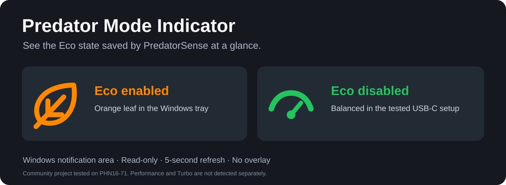
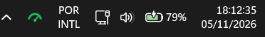

# Predator Mode Indicator

A Windows notification-area indicator for the profile saved by Acer PredatorSense. It refreshes every five seconds.

[Português](README.pt-BR.md) · [Download](https://github.com/MoisesGorisch/predator-mode-indicator/releases/latest)



| Icon | State |
| --- | --- |
| White moon | Quiet |
| Green gauge | Balanced |
| Purple lightning | Performance |
| Magenta rocket | Turbo |
| Orange leaf | Eco |
| Gray dot | State unavailable |

On the tested PHN16-71, the original adapter enables Quiet, Balanced, Performance and Turbo. The indicator reads the active scenario's saved profile when the PredatorSense log identifies the original adapter. On USB-C or battery it uses the saved Eco flag. If the adapter record is unavailable, the tooltip reports Eco enabled or disabled with the profile unknown.


The indicator reads the local configuration at `%ProgramData%\OEM\PredatorSense\ProfilePool\config.json` and the adapter status recorded in the local PredatorSense log. It reflects the profile saved by the app. Updates to the displayed profile and power source depend on PredatorSense saving and logging their changes.

## Compatibility

Tested locally on **Acer Predator Helios Neo 16 PHN16-71**, Windows, PredatorSense **5.0.1463**, with the original adapter and a USB-C PD charger. The four AC profile mappings passed automated checks. Performance was verified on the running tray app. Other models and PredatorSense versions are unverified. Requires Windows with .NET Framework 4.x and a compatible PredatorSense state file. Application menus are currently in Brazilian Portuguese.

## Use

1. Download the portable ZIP from [Releases](https://github.com/MoisesGorisch/predator-mode-indicator/releases).
2. Extract it to a permanent folder and run `IndicadorPredator.exe`.
3. If hidden under the tray arrow, drag the icon into the visible notification area.
4. Hover for the state; right-click for manual refresh, details or Exit.

No AutoHotkey, administrator rights or installer is required. Windows controls tray placement and visibility. There is no overlay window over games or video. Starting a second copy exits without creating another icon.

### Start with Windows

Press `Win+R`, enter `shell:startup` and place a **shortcut** to your extracted `IndicadorPredator.exe` there. To disable startup, remove that shortcut. Keep the executable in the same folder so the shortcut continues to work. Startup is optional and is not configured by merely opening the program.

## Build and verify

On Windows, use Windows PowerShell with the .NET Framework C# compiler already installed:

```powershell
.\build.ps1
.\test.ps1
```

The portable output is written to `dist`. Four multi-resolution ICO assets are embedded in the executable; external icon files are not needed at runtime. Editable SVG and transparent PNG versions are in `assets/icons`.

The checks exercise enabled, disabled, absent and malformed state files and load each embedded icon at small Windows icon sizes. They do not prove live compatibility with a different notebook; verify real mode changes on your own system.

## Privacy and scope

- Reads the local PredatorSense configuration and adapter status records.
- No networking, telemetry, firmware writes, service changes or power-profile changes.
- No scheduled task or automatic startup registration.
- Optional command-line diagnostics (`--status <file>`) write state changes locally. Normal use writes no diagnostic log.

## Contributing

Compatibility reports are welcome. Include the notebook model, Windows and PredatorSense versions, and whether a manual Eco toggle updates the icon. Do not upload your full PredatorSense configuration or private logs. For AC profiles, include the profile name shown by PredatorSense and the indicator tooltip.

Independent community project; not affiliated with or endorsed by Acer. Acer and PredatorSense names belong to their respective owners. Source code and custom icon artwork: [MIT license](LICENSE).
