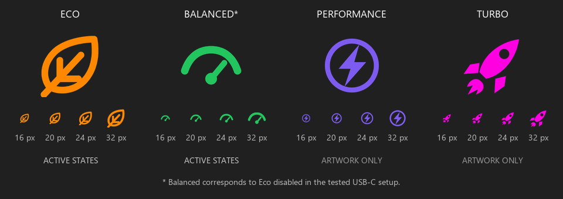

# Predator Mode Indicator

Indicador na área de notificação do Windows que acompanha o **estado Eco salvo pelo PredatorSense**, com atualização a cada cinco segundos.



- **Folha laranja:** Eco ativado (`Enable_Eco: 1`).
- **Velocímetro verde:** Eco desativado (`Enable_Eco: 0`). No cenário USB-C testado, corresponde ao Equilibrado.
- **Bolinha cinza:** estado ausente, ilegível ou não reconhecido.

**Verde não confirma Equilibrado em todos os cenários.** Com o carregador original, também pode representar Silencioso, Desempenho ou Turbo. O raio roxo e o foguete magenta estão prontos como artes, mas esses modos ainda não são detectados separadamente.

## Instalação e uso

Baixe e extraia o ZIP em [Releases](https://github.com/MoisesGorisch/predator-mode-indicator/releases) e execute `IndicadorPredator.exe`. Não precisa de AutoHotkey, instalação ou administrador. Se o ícone estiver na setinha de ícones ocultos, arraste-o para a área visível. O Windows controla sua posição.

Passe o mouse para ver o estado. Clique com o botão direito para atualizar manualmente, ver detalhes ou sair. O programa não cria uma janela sobre jogos ou vídeos.

Para iniciar com o Windows, pressione `Win+R`, digite `shell:startup` e coloque ali um **atalho** para o executável. Não mova o executável depois de criar o atalho. Para desativar, remova apenas o atalho. A inicialização automática não é ativada ao simplesmente abrir o programa.

## Origem e limites

O programa lê `%ProgramData%\OEM\PredatorSense\ProfilePool\config.json`. Não altera esse arquivo, energia, iluminação, serviços ou firmware. Não acessa a rede nem envia telemetria.

A leitura é do estado salvo pelo aplicativo, não do firmware, plano de energia do Windows ou potência USB-C. Se o PredatorSense não salvar as mudanças, o indicador pode ficar desatualizado. O formato do arquivo não é uma interface pública documentada.

Testado no **PHN16-71**, com **PredatorSense 5.0.1463** e carregador USB-C PD, nos modos Eco/Equilibrado. Outros modelos e versões não foram validados. Requer Windows com .NET Framework 4.x.

## Compilar

No Windows PowerShell:

```powershell
.\build.ps1
.\test.ps1
```

O resultado fica em `dist`. Os ícones estão incorporados ao executável; os SVGs e PNGs ficam em `assets/icons` para edição. Mais detalhes no [README em inglês](README.md).

Projeto independente, sem vínculo com a Acer. Código e artes próprias sob [licença MIT](LICENSE).
